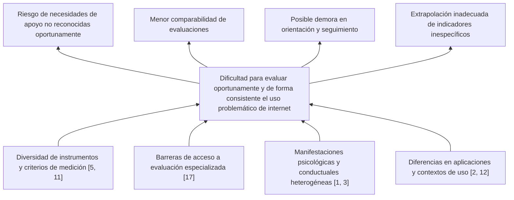

# Entrega 1 — Formulación del proyecto y revisión de antecedentes

**Universidad Icesi · Maestría en Inteligencia Artificial Aplicada · 2026-2**  
**Proyecto:** Estimación de la severidad del uso problemático de internet en niños y adolescentes.  
**Autora:** Viviana Fernández Payán · [GitHub: vivianaf926](https://github.com/vivianaf926)  
**Estado:** formulación revisada; los experimentos y resultados cuantitativos propios deben documentarse cuando se ejecuten.

> Esta entrega presenta el problema, las relaciones conceptuales, la pregunta de investigación, los objetivos, el estado del arte y el plan de trabajo. La bibliografía completa y su verificación están en [docs/referencias.md](../docs/referencias.md).

## 1. Presentación y contexto

Internet forma parte de las actividades de aprendizaje, comunicación y entretenimiento de niños y adolescentes. Su uso puede considerarse problemático cuando se acompaña de dificultades de autorregulación e interferencias significativas en el funcionamiento cotidiano. El fenómeno no equivale simplemente a pasar muchas horas conectado; requiere considerar los comportamientos observados, el contexto y las consecuencias funcionales [1], [11], [12].

Se han descrito asociaciones entre uso problemático de internet y síntomas de ansiedad, depresión, déficit de atención y otras manifestaciones del bienestar psicológico [1], [3], [14]. Estas relaciones no deben interpretarse automáticamente como causales: distintos factores pueden compartir antecedentes o influirse mutuamente. Otros estudios han investigado los patrones de uso de aplicaciones, los factores psicosociales y los instrumentos para su detección [2], [5], [12].

El **Child Mind Institute**, mediante la competición *Child Mind Institute — Problematic Internet Use* en Kaggle, propuso explorar si medidas físicas, información demográfica y datos de actividad ayudan a estimar cuatro niveles ordinales de severidad del uso problemático de internet en participantes del estudio **Healthy Brain Network (HBN)** [10], [17]. La propuesta de este proyecto es académica: examina la viabilidad y las limitaciones de la estimación mediante aprendizaje automático, no sustituye una evaluación clínica.

## 2. Delimitación y formulación del problema

La evaluación del uso problemático de internet presenta retos conceptuales y operativos: existen diferentes instrumentos y criterios de medición, manifestaciones heterogéneas y barreras para acceder a valoraciones especializadas [5], [11], [17]. Estas dificultades motivan el interés por estudiar indicadores complementarios, sin presuponer que sean equivalentes a una prueba diagnóstica.

Desde el punto de vista de ciencia de datos, el reto se concreta en **determinar cuánto pueden aportar indicadores no derivados directamente del cuestionario PCIAT para estimar la categoría ordinal de severidad `sii`**, teniendo en cuenta valores faltantes, cobertura desigual de instrumentos, posibles desequilibrios entre clases y riesgo de fuga de información [10].

### 2.1. Árbol de problemas y sustento

El árbol siguiente **organiza relaciones conceptuales plausibles** identificadas en los antecedentes. No representa un análisis causal probado experimentalmente:

*Figura 1. Síntesis conceptual de factores asociados a dificultades de evaluación y consecuencias potenciales. Los cuatro factores se apoyan en las fuentes citadas; las cuatro consecuencias se presentan como riesgos razonados, no como efectos causales cuantificados.*

El árbol presentado en la primera entrega, que incluía cuatro causas y cuatro consecuencias relacionadas con el fenómeno, se conserva aquí como **material histórico**, sin asumir que sus flechas demuestran causalidad:

*Figura 2. Árbol original de Viviana. Requiere distinguir factores asociados, antecedentes, posibles efectos y respaldo documental.*

### 2.2. Pregunta de investigación

> **¿En qué medida los modelos de aprendizaje automático pueden estimar los cuatro niveles de severidad del uso problemático de internet (`sii`) a partir de características demográficas, físicas y de comportamiento disponibles en HBN, y cuáles son las principales limitaciones de esa estimación?**

La investigación plantea una **estimación concurrente y retrospectiva**. No se dispone aquí de evidencia de que los predictores se hayan medido necesariamente antes del desenlace; por tanto, no se afirmará detección anticipada de casos futuros.

## 3. Objetivos del proyecto (criterios SMART)

### Objetivo general

Desarrollar y evaluar **antes de finalizar el periodo académico 2026-2** al menos **dos modelos supervisados** para estimar los **cuatro niveles de `sii`** a partir de variables del HBN, mediante validación cruzada estratificada de cinco particiones, utilizando el **coeficiente kappa cuadrático ponderado (QWK)** como métrica principal y **F1-macro** como métrica complementaria. Como meta académica **exploratoria**, se plantea alcanzar un QWK medio de al menos **0,35** y superar una línea base definida previamente.

*La meta de QWK es un criterio de trabajo propuesto; no es un resultado obtenido ni un umbral de validez clínica. Deberá interpretarse frente a la distribución de clases y la línea base.*

### Objetivos específicos

1. **Caracterizar la viabilidad del conjunto de datos** antes del entrenamiento mediante un informe que cuantifique participantes, disponibilidad de `sii`, distribución por nivel, proporción de datos faltantes, valores implausibles y criterios de inclusión y exclusión de variables.
2. **Construir al menos dos configuraciones reproducibles de predictores** con selección razonada de características y transformaciones documentadas, excluyendo la etiqueta `sii`, `PCIAT-PCIAT_Total` y campos que permitan reconstruir directamente el desenlace; ajustar imputación, codificación y escalamiento solo en entrenamiento.
3. **Entrenar y comparar al menos dos algoritmos supervisados** bajo el mismo esquema de validación estratificada de cinco particiones, documentando QWK, F1-macro, matriz de confusión y sensibilidad por categoría, especialmente para las clases minoritarias.
4. **Seleccionar y discutir el modelo mejor sustentado** antes del cierre académico, contrastándolo con la línea base y presentando un informe de errores, limitaciones de representatividad, condiciones de reproducibilidad y necesidades de validación externa.

Estos objetivos expresan resultados verificables. El análisis exploratorio y el preprocesamiento son medios para obtener productos concretos, no fines en sí mismos.

## 4. Antecedentes y estado del arte

### 4.1. Evidencia sobre medición y asociaciones

Gómez Salgado y colaboradores diseñaron y evaluaron un instrumento breve para detectar uso problemático de internet en adolescentes; reportaron **sensibilidad de 0,80 y especificidad de 0,81** en su estudio [5]. Por su parte, Kuss y Lopez-Fernandez revisaron estudios clínicos que muestran diversidad en la conceptualización y valoración del fenómeno [11]. Estos antecedentes justifican aclarar qué variable mide el proyecto antes de atribuir al algoritmo utilidad clínica.

Los trabajos de Ko y colaboradores [1], Yen y colaboradores [3] y van Rooij y colaboradores [12] examinaron asociaciones con síntomas psiquiátricos y patrones de utilización de aplicaciones. Fisoun y colaboradores [7] describieron asociaciones con experiencia de consumo de sustancias en un estudio transversal; sus resultados no establecen causalidad. Ninguno de esos estudios evalúa directamente el mismo problema ordinal `sii` del conjunto HBN.

### 4.2. Comparación de soluciones existentes

Los estudios de cribado y clasificación binaria aportan antecedentes sobre la medición del uso problemático de internet. Las dos soluciones de Kaggle usan los datos del HBN y estiman las cuatro categorías de `sii`. La columna de resultados indica la métrica y el conjunto en que se calculó cada valor.

| Fuente | Población y tarea | Método y evaluación | Resultado reportado | Aporte y limitación para el proyecto |
|---|---|---|---|---|
| Gómez Salgado y colaboradores (2014) [5] | 2.339 estudiantes de secundaria de Galicia. Cribado de riesgo en una encuesta escolar. | Evaluación psicométrica y análisis ROC. El grupo de riesgo se definió con criterios de uso diario prolongado y conflictos familiares por el uso de internet. | **AUC ROC 0,90**. Con el punto de corte de 19, **sensibilidad 80 %** y **especificidad 81,2 %**. | Ilustra el efecto del umbral sobre los errores de cribado. Usa un criterio de riesgo definido en la encuesta y un desenlace distinto de `sii`. |
| Hassani, Pakzad y Asghari (2018) [6] | 245 estudiantes de una universidad iraní. Clasificación binaria de niveles derivados del *Internet Addiction Test* (IAT). | K vecinos más cercanos, selección de variables mediante algoritmos heurísticos, balanceo con SMOTE y validación cruzada de 10 particiones. | **Exactitud máxima de 99,75 %** tras el balanceo y **94,70 %** con los datos originales (tablas 3 y 4). | El modelo usa ítems del mismo cuestionario del que se deriva la etiqueta. El artículo describe el balanceo antes de la selección de variables y deja sin aclarar su aislamiento por partición. Esto limita la interpretación de la exactitud. |
| Ioannidis y colaboradores (2016) [8] | 2.006 adultos de Chicago y Stellenbosch, con 181 casos. Clasificación binaria de uso problemático de internet. | Regresión logística, bosque aleatorio y *naïve Bayes*. Evaluación con 50 repeticiones por esquema, particiones 75/25 dentro de muestra y pruebas entre sedes. | En el análisis combinado **AUC ROC 0,84** y **AUC precisión–recobrado 0,20** para el bosque aleatorio. La regresión logística obtuvo **0,83** y **0,26**, respectivamente. | Con pocos casos positivos, ambos indicadores ofrecen perspectivas distintas del desempeño. La población adulta y el desenlace binario limitan su traslado a `sii`. |
| Haupts (primer puesto de Kaggle) [15] | HBN. Estimación del puntaje total PCIAT como desenlace continuo y conversión a `sii`. | Ensamble por votación de LightGBM, dos modelos XGBoost, CatBoost y ExtraTrees. El notebook usa 10 particiones estratificadas por `sii` y calibra umbrales con los datos de entrenamiento de cada partición. | **QWK 0,469** del ensamble sobre las predicciones de validación de las 10 particiones, según la salida del [notebook](https://www.kaggle.com/code/lennarthaupts/1st-place-cmi-model-v4-1-1-reduced?scriptVersionId=213769368). | Ofrece un ejemplo de regresión seguida de clasificación ordinal. La imputación del notebook se ajusta antes de la validación cruzada. El puntaje corresponde a una evaluación interna del cuaderno. |
| Agarwal (segundo puesto de Kaggle) [16] | HBN. Regresión multisalida con CatBoost y conversión de la predicción del total PCIAT a `sii`. | Imputación según el tipo de variable y 20 particiones estratificadas por `sii`. Ajusta los umbrales con el conjunto de predicciones de validación. | **QWK 0,409** en la ejecución guardada del [notebook](https://www.kaggle.com/code/aradhyeagarwal/starter-notebook-with-polars-gpu), configurada con una iteración por modelo al usar el archivo de prueba de ejemplo. El autor reportó **0,435** en el tablero público para ese notebook. | La imputación usa conjuntamente las variables de entrenamiento y prueba antes de dividir las particiones. Además, el QWK interno se calculó sobre las mismas predicciones usadas para ajustar los umbrales. |

Las cifras de AUC, exactitud y QWK responden a tareas y métricas diferentes. Los QWK de 0,469 y 0,409 provienen de ejecuciones con protocolos distintos. Para los dos primeros puestos se verificó la posición final. Las cifras exactas de sus envíos en el tablero privado quedaron sin confirmar en los reportes y notebooks consultados.

La revisión de Kato y colaboradores [4] aporta un marco general sobre modelos computacionales de adicciones conductuales. Probierz y colaboradores [9] exploran algoritmos predictivos en datos de ciencias sociales. Feng y colaboradores [13] emplearon conectividad cerebral, una modalidad diferente de los indicadores tabulares de este proyecto. Los tres trabajos aportan contexto conceptual o metodológico.

**Brecha del proyecto.** Se evaluará cuánto añade cada grupo de variables frente a una línea base bajo las mismas particiones y métricas. La selección de variables, la imputación y cualquier ajuste de umbrales se harán con datos de entrenamiento de cada partición. La evaluación reportará QWK, F1-macro y errores por nivel de `sii`, con atención a las clases minoritarias.

### 4.3. Relación con las variables candidatas

En HBN se incluyen instrumentos demográficos, medidas corporales y de aptitud física, cuestionarios de sueño y actividad, categorías de uso de internet y actigrafía [10]. La disponibilidad y la oportunidad temporal de cada predictor deben comprobarse antes de incorporarlo. La asociación estadística entre una variable y `sii` no constituye por sí misma prueba causal ni criterio suficiente de selección.

Los dos cuadros de síntesis elaborados originalmente se mantienen como antecedentes visuales; esta comparación narrativa es la que fundamenta explícitamente método, hallazgos y límites:

*Figura 3. Cuadro original de modelos; interpretar junto con la tabla de comparación y las referencias corregidas.*

*Figura 4. Cuadro original de variables candidatas. Su pertinencia debe contrastarse con el diccionario y la calidad del HBN.*

## 5. Enfoque metodológico y evaluación

Se utilizará una adaptación de **CRISP-DM**: comprensión del problema, comprensión y preparación de los datos, modelado, evaluación y comunicación. La fuente prevista es el conjunto de la competencia Child Mind Institute — Problematic Internet Use [10].

| Etapa | Procedimiento propuesto | Evidencia esperada |
|---|---|---|
| Comprensión de datos | Diccionario, cobertura, faltantes, plausibilidad, distribución `sii`. | Informe EDA y matriz de variables. |
| Preparación | Exclusión de predictores con fuga; imputación y codificación dentro de entrenamiento. | Flujo reproducible de transformación. |
| Modelado | Línea base y al menos dos algoritmos supervisados bajo cinco particiones estratificadas. | Configuraciones y código documentado. |
| Evaluación | QWK principal, F1-macro y matrices de confusión; sensibilidad por clase. | Tabla comparativa y análisis de errores. |
| Discusión | Limitaciones de temporalidad, datos faltantes, desbalance, extrapolación y ética. | Informe final y recomendaciones metodológicas. |

La etiqueta `sii` procede del puntaje `PCIAT-PCIAT_Total` [10]. **No es válido utilizar este puntaje como una variable de entrada para predecir `sii`**; ello reconstruiría la respuesta. En cambio, entrenar una regresión cuyo *desenlace* sea el puntaje total y luego transformar sus predicciones a categorías es una estrategia distinta, documentada por Haupts [15], que requiere su propia validación.

El QWK considera que los niveles son ordenados; F1-macro y las matrices de confusión permitirán identificar diferencias entre clases. No se equipararán QWK, ROC-AUC, exactitud y errores de regresión sin explicar las tareas y escalas correspondientes.

## 6. Planificación y materiales de la entrega original

El proyecto contempla las actividades de revisión de antecedentes, comprensión de datos, preparación, entrenamiento, evaluación y documentación. Los diagramas originales de desglose de trabajo y cronograma se conservan como evidencia histórica de su planificación:

*Figura 5. Estructura de desglose de trabajo (EDT) presentada originalmente.*

*Figura 6. Cronograma original. Las fechas específicas deben contrastarse con los plazos de la asignatura.*

| Periodo | Actividad | Producto |
|---|---|---|
| Primera etapa | Formulación y revisión bibliográfica | Presente documento y referencias verificadas. |
| Segunda etapa | EDA, preparación y modelos de referencia | Informe, código y resultados **cuando se ejecuten**. |
| Etapa final | Comparación, discusión y sustentación | Informe final y presentación académica. |

## 7. Alcance, limitaciones y ética

El conjunto HBN tiene datos faltantes y diferencias de cobertura entre instrumentos [10]. Los resultados internos de una muestra no demuestran desempeño en otras poblaciones. Tampoco se debe inferir causalidad, capacidad diagnóstica, riesgo clínico individual ni predicción futura sin evidencia temporal y validación externa.

Este repositorio documenta el **proyecto académico de Viviana**; no incluye todavía resultados cuantitativos propios, notebooks ejecutables ni bases individuales. Cuando se publiquen resultados, deberán acompañarse de metodología, particiones, métricas y limitaciones verificables. Los datos originales se obtendrán desde Kaggle respetando sus condiciones de uso.

## 8. Cierre de la formulación

La propuesta delimita un problema de estimación ordinal sobre datos heterogéneos de niños y adolescentes. La revisión científica y los reportes técnicos de la competencia sustentan la pertinencia de explorar modelos, pero no autorizan a anticipar un rendimiento ni una utilidad clínica. El valor académico del proyecto dependerá de una comparación reproducible, control de fuga de información e interpretación crítica del error por categoría.

**Fuentes:** [Bibliografía completa, con autoría y enlaces verificados](../docs/referencias.md) · [Bitácora de correcciones](../docs/bitacora_bibliografica.md).
