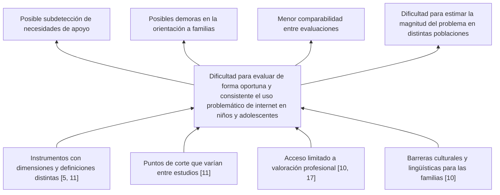
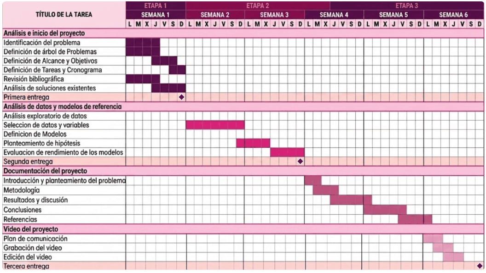

# Entrega 1 — Formulación del proyecto y revisión de antecedentes

**Universidad Icesi · Maestría en Inteligencia Artificial Aplicada · 2026-2**  
**Proyecto:** Estimación de la severidad del uso problemático de internet en niños y adolescentes.  
**Autora:** Viviana Fernández Payán · [GitHub: vivianaf926](https://github.com/vivianaf926)  
**Estado:** formulación y revisión de antecedentes. La evaluación experimental corresponde a la siguiente etapa.

> En esta primera entrega delimito el problema, formulo la pregunta de investigación y los objetivos, reviso los antecedentes y presento el plan de trabajo.

## 1. Presentación y contexto

Internet forma parte de las actividades de aprendizaje, comunicación y entretenimiento de niños y adolescentes. Su uso puede considerarse problemático cuando se acompaña de dificultades de autorregulación e interferencias significativas en el funcionamiento cotidiano. El fenómeno no equivale simplemente a pasar muchas horas conectado; requiere considerar los comportamientos observados, el contexto y las consecuencias funcionales [1], [11], [12].

Se han descrito asociaciones entre uso problemático de internet y síntomas de ansiedad, depresión, déficit de atención y otras manifestaciones del bienestar psicológico [1], [3], [14]. Estas relaciones no deben interpretarse automáticamente como causales: distintos factores pueden compartir antecedentes o influirse mutuamente. Otros estudios han investigado los patrones de uso de aplicaciones, los factores psicosociales y los instrumentos para su detección [2], [5], [12].

El **Child Mind Institute**, mediante la competición *Child Mind Institute — Problematic Internet Use* en Kaggle, propuso explorar si medidas físicas, información demográfica y datos de actividad ayudan a estimar cuatro niveles ordinales de severidad del uso problemático de internet en participantes del estudio **Healthy Brain Network (HBN)** [10], [17]. A partir de este reto, me propongo examinar la viabilidad y las limitaciones de estimar la severidad con aprendizaje automático en los datos del HBN.

## 2. Delimitación y formulación del problema

Para evaluar el uso problemático de internet en niños y adolescentes se requiere considerar cómo se mide el fenómeno y quién puede acceder a la valoración. Los instrumentos y los puntos de corte varían entre estudios [5], [11]. Algunos métodos requieren valoración profesional y pueden resultar difíciles de aplicar en familias con barreras culturales o lingüísticas [10], [17]. Estas dificultades motivan explorar indicadores complementarios de severidad.

Examinaré cuánto aportan **los indicadores que no se deriven del cuestionario PCIAT para estimar la categoría ordinal de severidad `sii`**. Tendré en cuenta los valores faltantes, la cobertura de los instrumentos, el desbalance entre clases y el riesgo de fuga de información [10].

### 2.1. Árbol de problemas y sustento

El árbol se centra en la dificultad para evaluar el uso problemático de internet de forma oportuna y consistente en niños y adolescentes. Las raíces recogen dificultades de medición y acceso descritas en las fuentes. Las ramas muestran sus posibles consecuencias para la detección, la orientación y la interpretación de las evaluaciones.

*Figura 1. Factores que pueden dificultar la evaluación y consecuencias potenciales. Las flechas representan relaciones conceptuales.* Fuentes [5], [10], [11], [17].

Las diferencias en instrumentos y puntos de corte dificultan comparar resultados y estimar la magnitud del problema entre poblaciones [11]. Las barreras de acceso pueden reducir la probabilidad de que una necesidad de apoyo se reconozca o se atienda oportunamente [10], [17]. Los estudios sobre síntomas psicológicos y patrones de uso se discuten en los antecedentes [1], [2], [3], [12].

*Figura 2. Versión inicial del árbol de problemas presentada en la primera entrega.*

### 2.2. Pregunta de investigación

> **¿En qué medida los modelos de aprendizaje automático pueden estimar los cuatro niveles de severidad del uso problemático de internet (`sii`) a partir de características demográficas, físicas y de comportamiento disponibles en HBN, y cuáles son las principales limitaciones de esa estimación?**

Planteo una **estimación concurrente y retrospectiva** con las mediciones disponibles en el HBN, cuya secuencia temporal respecto a `sii` requiere verificación.

## 3. Objetivos del proyecto (criterios SMART)

### Objetivo general

Desarrollar y evaluar **antes de finalizar el periodo académico 2026-2** al menos **dos modelos supervisados** para estimar los **cuatro niveles de `sii`** a partir de variables del HBN, mediante validación cruzada estratificada de cinco particiones, utilizando el **coeficiente kappa cuadrático ponderado (QWK)** como métrica principal y **F1-macro** como métrica complementaria. Como meta académica **exploratoria**, se plantea alcanzar un QWK medio de al menos **0,35** y superar una línea base definida previamente.

*Interpretaré la meta exploratoria de QWK frente a la distribución de clases y al desempeño de la línea base.*

### Objetivos específicos

1. **Caracterizar la viabilidad del conjunto de datos** antes del entrenamiento mediante un informe que cuantifique participantes, disponibilidad de `sii`, distribución por nivel, proporción de datos faltantes, valores implausibles y criterios de inclusión y exclusión de variables.
2. **Construir al menos dos configuraciones reproducibles de predictores** con selección razonada de características y transformaciones documentadas, excluyendo la etiqueta `sii`, `PCIAT-PCIAT_Total` y campos que permitan reconstruir directamente el desenlace; ajustar imputación, codificación y escalamiento solo en entrenamiento.
3. **Entrenar y comparar al menos dos algoritmos supervisados** bajo el mismo esquema de validación estratificada de cinco particiones, documentando QWK, F1-macro, matriz de confusión y sensibilidad por categoría, especialmente para las clases minoritarias.
4. **Seleccionar y discutir el modelo mejor sustentado** antes del cierre académico, contrastándolo con la línea base y presentando un informe de errores, limitaciones de representatividad, condiciones de reproducibilidad y necesidades de validación externa.

## 4. Antecedentes y estado del arte

### 4.1. Evidencia sobre medición y asociaciones

Gómez Salgado y colaboradores diseñaron y evaluaron un instrumento breve para detectar uso problemático de internet en adolescentes; reportaron **sensibilidad de 0,80 y especificidad de 0,81** en su estudio [5]. Por su parte, Kuss y Lopez-Fernandez revisaron estudios clínicos que muestran diversidad en la conceptualización y valoración del fenómeno [11]. Estos antecedentes justifican aclarar qué variable mide el proyecto antes de atribuir al algoritmo utilidad clínica.

Los trabajos de Ko y colaboradores [1], Yen y colaboradores [3] y van Rooij y colaboradores [12] examinaron asociaciones con síntomas psiquiátricos y patrones de utilización de aplicaciones. Fisoun y colaboradores [7] describieron asociaciones con experiencia de consumo de sustancias en un estudio transversal; sus resultados no establecen causalidad. Ninguno de esos estudios evalúa directamente el mismo problema ordinal `sii` del conjunto HBN.

### 4.2. Comparación de métodos y modelos en estudios previos

Comparo estudios de cribado, trabajos de clasificación binaria y dos soluciones de Kaggle que estimaron las cuatro categorías de `sii` en el HBN. La tabla resume cómo se evaluó cada método y qué aporta al proyecto.

| Fuente | Población y tarea | Método y evaluación | Resultado reportado | Aporte y limitación para el proyecto |
|---|---|---|---|---|
| Gómez Salgado y colaboradores (2014) [5] | 2.339 estudiantes de secundaria de Galicia. Cribado de riesgo en una encuesta escolar. | Evaluación psicométrica y análisis ROC. El grupo de riesgo se definió con criterios de uso diario prolongado y conflictos familiares por el uso de internet. | **AUC ROC 0,90**. Con el punto de corte de 19, **sensibilidad 80 %** y **especificidad 81,2 %**. | Ilustra el efecto del umbral sobre los errores de cribado. Usa un criterio de riesgo definido en la encuesta y un desenlace distinto de `sii`. |
| Hassani, Pakzad y Asghari (2018) [6] | 245 estudiantes de una universidad iraní. Clasificación binaria de niveles derivados del *Internet Addiction Test* (IAT). | K vecinos más cercanos, selección de variables mediante algoritmos heurísticos, balanceo con SMOTE y validación cruzada de 10 particiones. | **Exactitud máxima de 99,75 %** tras el balanceo y **94,70 %** con los datos originales (tablas 3 y 4). | El modelo usa ítems del mismo cuestionario del que se deriva la etiqueta. El artículo describe el balanceo antes de la selección de variables y deja sin aclarar su aislamiento por partición. Esto limita la interpretación de la exactitud. |
| Ioannidis y colaboradores (2016) [8] | 2.006 adultos de Chicago y Stellenbosch, con 181 casos. Clasificación binaria de uso problemático de internet. | Regresión logística, bosque aleatorio y *naïve Bayes*. Evaluación con 50 repeticiones por esquema, particiones 75/25 dentro de muestra y pruebas entre sedes. | En el análisis combinado **AUC ROC 0,84** y **AUC precisión–recobrado 0,20** para el bosque aleatorio. La regresión logística obtuvo **0,83** y **0,26**, respectivamente. | Con pocos casos positivos, ambos indicadores ofrecen perspectivas distintas del desempeño. La población adulta y el desenlace binario limitan su traslado a `sii`. |
| Haupts (primer puesto de Kaggle) [15] | HBN. Estimación del puntaje total PCIAT como desenlace continuo y conversión a `sii`. | Ensamble por votación de LightGBM, dos modelos XGBoost, CatBoost y ExtraTrees. El notebook usa 10 particiones estratificadas por `sii` y calibra umbrales con los datos de entrenamiento de cada partición. | **QWK 0,469** del ensamble sobre las predicciones de validación de las 10 particiones, según la salida del [notebook](https://www.kaggle.com/code/lennarthaupts/1st-place-cmi-model-v4-1-1-reduced?scriptVersionId=213769368). | Ofrece un ejemplo de regresión seguida de clasificación ordinal. La imputación del notebook se ajusta antes de la validación cruzada. El puntaje corresponde a una evaluación interna del cuaderno. |
| Agarwal (segundo puesto de Kaggle) [16] | HBN. Regresión multisalida con CatBoost y conversión de la predicción del total PCIAT a `sii`. | Imputación según el tipo de variable y 20 particiones estratificadas por `sii`. Ajusta los umbrales con el conjunto de predicciones de validación. | **QWK 0,409** en la ejecución guardada del [notebook](https://www.kaggle.com/code/aradhyeagarwal/starter-notebook-with-polars-gpu), configurada con una iteración por modelo al usar el archivo de prueba de ejemplo. El autor reportó **0,435** en el tablero público para ese notebook. | La imputación usa conjuntamente las variables de entrenamiento y prueba antes de dividir las particiones. Además, el QWK interno se calculó sobre las mismas predicciones usadas para ajustar los umbrales. |

Las cifras de AUC, exactitud y QWK responden a tareas y métricas diferentes. Los reportes de Kaggle documentan la evaluación técnica de los modelos para la competencia. Los QWK de 0,469 y 0,409 provienen de ejecuciones con protocolos distintos. Los puestos corresponden a la clasificación final de la competencia. Los puntajes exactos del tablero privado quedaron sin confirmar en los reportes y cuadernos consultados.

La revisión de Kato y colaboradores [4] aporta un marco general sobre modelos computacionales de adicciones conductuales. Probierz y colaboradores [9] exploran algoritmos predictivos en datos de ciencias sociales. Feng y colaboradores [13] emplearon conectividad cerebral, una modalidad diferente de los indicadores tabulares de este proyecto. Los tres trabajos aportan contexto conceptual o metodológico.

**Brecha del proyecto.** Se evaluará cuánto añade cada grupo de variables frente a una línea base bajo las mismas particiones y métricas. La selección de variables, la imputación y cualquier ajuste de umbrales se harán con datos de entrenamiento de cada partición. La evaluación reportará QWK, F1-macro y errores por nivel de `sii`, con atención a las clases minoritarias.

### 4.3. Relación con las variables candidatas

En HBN se incluyen instrumentos demográficos, medidas corporales y de aptitud física, cuestionarios de sueño y actividad, categorías de uso de internet y actigrafía [10]. La disponibilidad y la oportunidad temporal de cada predictor deben comprobarse antes de incorporarlo. La asociación estadística entre una variable y `sii` no constituye por sí misma prueba causal ni criterio suficiente de selección.

Los siguientes cuadros resumen los modelos y las variables candidatas que consideré al formular el proyecto.

*Figura 3. Resumen de modelos considerados en la formulación del proyecto.*

*Figura 4. Variables candidatas para contrastar con el diccionario y con la calidad de los datos del HBN.*

## 5. Enfoque metodológico y evaluación

Guiaré el proyecto con una adaptación de **CRISP-DM** para delimitar el problema, preparar los datos, evaluar los modelos y comunicar los resultados. Usaré los datos del HBN publicados en la competencia del Child Mind Institute [10].

### 5.1. Modelos propuestos

Para estimar los cuatro niveles de severidad de `sii`, propongo comparar una línea base y dos clasificadores supervisados. La regresión logística y el bosque aleatorio tienen un antecedente en la clasificación binaria de uso problemático de internet [8]. Evaluaré sus versiones multiclase en el HBN.

| Método | Papel en la comparación |
|---|---|
| **Línea base de clase mayoritaria** | Asigna a cada registro la clase más frecuente del conjunto de entrenamiento de su partición. Permite observar el desempeño de una regla que solo usa la frecuencia de las clases. |
| **Regresión logística multinomial regularizada** | Estima la probabilidad de cada nivel de severidad mediante un modelo lineal. |
| **Bosque aleatorio** | Combina árboles de decisión para explorar relaciones no lineales e interacciones entre predictores. |

### 5.2. Protocolo de evaluación

Utilizaré las mismas cinco particiones estratificadas para la línea base y los modelos. La imputación, la codificación y, cuando corresponda, el escalamiento y la selección de variables se ajustarán con los datos de entrenamiento de cada partición. Se excluirán de los predictores `sii`, `PCIAT-PCIAT_Total` y los ítems o campos que permitan reconstruir la etiqueta [10].

El **kappa cuadrático ponderado (QWK)** será la métrica principal porque penaliza más los errores entre niveles de severidad alejados. Se reportarán también F1-macro, la matriz de confusión y la sensibilidad por categoría, con atención a las clases minoritarias.

## 6. Plan de trabajo y cronograma

### 6.1. Tareas y entregables

Organicé las tareas según los objetivos específicos y los productos de cada entrega.

| Tarea | Actividades | Producto verificable |
|---|---|---|
| Formular el problema | Delimitar el alcance, construir el árbol de problemas, definir los objetivos y comparar los antecedentes. | Documento de formulación y bibliografía verificada. |
| Auditar y preparar los datos | Revisar la disponibilidad de la etiqueta, el desbalance, los valores faltantes y la plausibilidad de los registros. Definir al menos dos conjuntos de predictores y documentar sus transformaciones. | Informe exploratorio, matriz de variables y código de preparación. |
| Entrenar y evaluar los modelos | Ejecutar la línea base y los clasificadores con las mismas particiones. Comparar las métricas y revisar los errores por nivel de severidad. | Código de modelado, tabla de resultados y análisis de errores. |
| Integrar y comunicar los resultados | Documentar el método, discutir limitaciones, elaborar las conclusiones y preparar el video del proyecto. | Informe final y video de presentación. |

*Figura 5. Estructura de desglose de trabajo (EDT) de la primera entrega.*

### 6.2. Cronograma

*Figura 6. Cronograma del proyecto. Las barras indican la duración de las actividades. Cada rombo (◆) marca un hito previsto al cierre de su etapa. Las fechas y horas límite se confirmarán con el calendario oficial de la asignatura.*

## 7. Alcance, limitaciones y ética

El conjunto HBN tiene datos faltantes y diferencias de cobertura entre instrumentos [10]. Los resultados internos de una muestra no demuestran desempeño en otras poblaciones. Tampoco se debe inferir causalidad, capacidad diagnóstica, riesgo clínico individual ni predicción futura sin evidencia temporal y validación externa.

Presentaré los resultados junto con la metodología, las particiones, las métricas y sus limitaciones cuando complete los experimentos. El acceso a los datos del HBN se realiza a través de Kaggle, de acuerdo con las condiciones de la competencia.

## 8. Cierre de la formulación

La propuesta delimita un problema de estimación ordinal sobre datos heterogéneos de niños y adolescentes. La revisión científica y los reportes técnicos de la competencia sustentan la pertinencia de explorar modelos, pero no autorizan a anticipar un rendimiento ni una utilidad clínica. El valor académico del proyecto dependerá de una comparación reproducible, control de fuga de información e interpretación crítica del error por categoría.

## Referencias

**\[1\]** C.-H. Ko, J.-Y. Yen, C.-F. Yen, C.-S. Chen y C.-C. Chen, “The association between Internet addiction and psychiatric disorder: A review of the literature”, *European Psychiatry*, vol. 27, n.º 1, pp. 1–8, 2012. DOI: <https://doi.org/10.1016/j.eurpsy.2010.04.011>.

**\[2\]** D. J. Kuss, A. J. van Rooij, G. W. Shorter, M. D. Griffiths y D. van de Mheen, “Internet addiction in adolescents: Prevalence and risk factors”, *Computers in Human Behavior*, vol. 29, n.º 5, pp. 1987–1996, 2013. DOI: <https://doi.org/10.1016/j.chb.2013.04.002>.

**\[3\]** J.-Y. Yen, C.-H. Ko, C.-F. Yen, S.-H. Chen, W.-L. Chung y C.-C. Chen, “Psychiatric symptoms in adolescents with Internet addiction: Comparison with substance use”, *Psychiatry and Clinical Neurosciences*, vol. 62, n.º 1, pp. 9–16, 2008. DOI: <https://doi.org/10.1111/j.1440-1819.2007.01770.x>.

**\[4\]** A. Kato, K. Shimomura, D. Ognibene, M. A. Parvaz, L. A. Berner, K. Morita y V. G. Fiore, “Computational models of behavioral addictions: State of the art and future directions”, *Addictive Behaviors*, vol. 140, art. 107595, 2023. DOI: <https://doi.org/10.1016/j.addbeh.2022.107595>.

**\[5\]** P. Gómez Salgado, A. Rial Boubeta, T. Braña Tobío, J. Varela Mallou y C. Barreiro Couto, “Evaluation and early detection of problematic Internet use in adolescents”, *Psicothema*, vol. 26, n.º 1, pp. 21–26, 2014. DOI: <https://doi.org/10.7334/psicothema2013.109>.

**\[6\]** Z. Hassani, A. Pakzad y A. Asghari, “An Artificial Predictive Modeling Framework for Automatically Detecting Problematic Use of Internet”, *International Journal of Computer Applications*, vol. 179, n.º 41, pp. 31–38, 2018. DOI: <https://doi.org/10.5120/ijca2018916983>.

**\[7\]** V. Fisoun, G. Floros, K. Siomos, D. Geroukalis y K. Navridis, “Internet addiction as an important predictor in early detection of adolescent drug use experience—implications for research and practice”, *Journal of Addiction Medicine*, vol. 6, n.º 1, pp. 77–84, 2012. DOI: <https://doi.org/10.1097/ADM.0b013e318233d637>.

**\[8\]** K. Ioannidis, S. R. Chamberlain, M. S. Treder, F. Kiraly, E. W. Leppink, S. A. Redden, D. J. Stein, C. Lochner y J. E. Grant, “Problematic internet use (PIU): Associations with the impulsive-compulsive spectrum. An application of machine learning in psychiatry”, *Journal of Psychiatric Research*, vol. 83, pp. 94–102, 2016. DOI: <https://doi.org/10.1016/j.jpsychires.2016.08.010>.

**\[9\]** E. Probierz, W. Sikora, A. Gałuszka y A. Gałuszka, “Predictive Algorithms in Social Sciences – Problematic Internet Use Example”, en *Man-Machine Interactions 6*, *Advances in Intelligent Systems and Computing*, vol. 1061, pp. 89–98, Springer, 2020. DOI: <https://doi.org/10.1007/978-3-030-31964-9_9>.

**\[10\]** Child Mind Institute y Kaggle, “Child Mind Institute — Problematic Internet Use”, descripción oficial de la competición y los datos, 2024. <https://www.kaggle.com/competitions/child-mind-institute-problematic-internet-use>.

**\[11\]** D. J. Kuss y O. Lopez-Fernandez, “Internet addiction and problematic Internet use: A systematic review of clinical research”, *World Journal of Psychiatry*, vol. 6, n.º 1, pp. 143–176, 2016. DOI: <https://doi.org/10.5498/wjp.v6.i1.143>.

**\[12\]** A. J. van Rooij, C. J. Ferguson, D. van de Mheen y T. M. Schoenmakers, “Time to abandon Internet addiction? Predicting problematic internet, game, and social media use from psychosocial well-being and application use”, *Clinical Neuropsychiatry*, vol. 14, n.º 1, pp. 113–121, 2017. Registro institucional: <https://research.tilburguniversity.edu/en/publications/time-to-abandon-internet-addiction-predicting-problematic-interne/>.

**\[13\]** Q. Feng, Z. Ren, D. Wei, C. Liu, X. Wang, X. Li, B. Tie, S. Tang y J. Qiu, “Connectome-based predictive modeling of Internet addiction symptomatology”, *Social Cognitive and Affective Neuroscience*, vol. 19, n.º 1, art. nsae007, 2024. DOI: <https://doi.org/10.1093/scan/nsae007>.

**\[14\]** C.-H. Ko, J.-Y. Yen, C.-S. Chen, Y.-C. Yeh y C.-F. Yen, “Predictive values of psychiatric symptoms for Internet addiction in adolescents: A 2-year prospective study”, *Archives of Pediatrics & Adolescent Medicine*, vol. 163, n.º 10, pp. 937–943, 2009. DOI: <https://doi.org/10.1001/archpediatrics.2009.159>.

**\[15\]** L. Haupts, “First Place Write-Up: Or How I Won the Lottery”, *Kaggle*, 2 de enero de 2025. <https://www.kaggle.com/competitions/child-mind-institute-problematic-internet-use/writeups/lennart-haupts-first-place-write-up-or-how-i-won-t>.

**\[16\]** A. Agarwal, “2nd Place Writeup”, *Kaggle*, 2024. <https://www.kaggle.com/competitions/child-mind-institute-problematic-internet-use/writeups/aradhye-agarwal-2nd-place-writeup>.

**\[17\]** Child Mind Institute, “Child Mind Institute and Kaggle Launch Competition to Predict Teen Internet Addiction”, comunicado del 19 de septiembre de 2024. <https://childmind.org/blog/child-mind-institute-and-kaggle-launch-competition-to-predict-teen-internet-addiction/>.

[Anexo. Bitácora de revisión bibliográfica](../docs/bitacora_bibliografica.md).

[1]: #referencia-1
[2]: #referencia-2
[3]: #referencia-3
[4]: #referencia-4
[5]: #referencia-5
[6]: #referencia-6
[7]: #referencia-7
[8]: #referencia-8
[9]: #referencia-9
[10]: #referencia-10
[11]: #referencia-11
[12]: #referencia-12
[13]: #referencia-13
[14]: #referencia-14
[15]: #referencia-15
[16]: #referencia-16
[17]: #referencia-17
